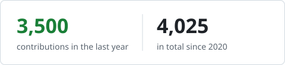

# Sandesh Bhusal

**Embedded & Full-Stack Engineer** at EVON Electric, Nepal · Co-founder of [Noobsbot](https://github.com/noobsbot-team)

I build the software for an electric motorbike: the firmware in the vehicle,
the dashboard, the charger, the phone app and the server behind it.
At EVON I am the only software and embedded developer (since November 2025).

## What I work on

- **EV firmware:** STM32 + FreeRTOS vehicle control unit, ESP32 dashboards, charge controllers, BMS and motor controller links
- **Buses:** CAN, RS485 / Modbus, UART, BLE, LTE modems
- **Reverse engineering:** flash dumps, firmware unpacking, MCU patching on a CarPlay motorbike dashboard (Allwinner Linux + Cortex-M0)
- **Apps and backend:** Flutter app with an Apple Watch companion, PHP / MariaDB API, fleet telematics over LTE
- **Rust:** desktop apps with the Noobsbot team

## Check out my work

| Project | What it is |
|---|---|
| [fardriver-can-notes](https://github.com/sande5h/fardriver-can-notes) | Control a Fardriver motor controller over CAN and UART: speed mode, forward / neutral / reverse, cruise. Tested on a real bike. |
| [jk-bms-can-esp32](https://github.com/sande5h/jk-bms-can-esp32) | ESP32-S3 firmware that reads and controls a JK BMS over CAN, with RS485 Modbus notes. |
| [matrix_panel](https://github.com/sande5h/matrix_panel) | HUB75 LED panel driver for the ESP32-S3 using LCD_CAM + DMA: video, clock, web API, updates over Wi-Fi. |
| [noobsbot-terminal](https://github.com/noobsbot-team/noobsbot-terminal) | GPU terminal for Linux and macOS in Rust. I did the macOS port, signing and CI. |
| [noobsbot-desktop](https://github.com/noobsbot-team/noobsbot-desktop) | Wayland desktop for Linux in Rust. I added Debian 13 support and its installer. |
| [claude_usage_desktop](https://github.com/sande5h/claude_usage_desktop) | Desk gadget (ESP32-C3 + OLED) and menu bar app that show AI usage limits. |

## Highlights

- Got speed modes and forward / neutral / reverse working over CAN on a Fardriver controller, and wrote the setup guide.
- Dumped, decoded and patched a CarPlay motorbike dashboard so it shows our BMS and motor data.
- Proved an IoT SIM works in Nepal and built a fleet server with firmware updates over LTE.
- Built the EVON phone app on my own: BLE pairing, battery diagnostics, firmware update over BLE.
- Runner-up, Yantra 9.0 robotics challenge (2024).

## Tools

- **Languages:** C · C++ · Rust · Python · Dart · Swift · TypeScript · PHP
- **Frameworks:** ESP-IDF · STM32 HAL · FreeRTOS · LVGL · Flutter · Next.js
- **Tools:** KiCad · Fusion 360 · Git · GitHub Actions · Docker · Linux

## My GitHub activity

<picture>
  <source media="(prefers-color-scheme: dark)" srcset="https://raw.githubusercontent.com/sande5h/sande5h/output/contributions-dark.svg">
  
</picture>

<picture>
  <source media="(prefers-color-scheme: dark)" srcset="https://raw.githubusercontent.com/sande5h/sande5h/output/github-snake-dark.svg">
  
</picture>

## Let's Collab!

I like building real hardware and software solutions: EV systems, CAN, embedded
displays and the apps that talk to them. If you have a project like that, get in touch.

## Reach Me

- **LinkedIn:** [linkedin.com/in/sande5h](https://www.linkedin.com/in/sande5h/)
- **Email:** bhusalsandesh0@gmail.com
